<h1 align="center">👋 Hi there, I'm Daniel Guillamón</h1>
<h3 align="center">💻 Full-Stack & Mobile Web Development Student from Spain 🇪🇸</h3>

⚡ <i>Bridging Systems Infrastructure (SMX) with Full-Stack & Mobile Software Engineering (DAWe)</i>

---

### 📝 About Me

- 🌱 **Currently:** Pursuing a Higher-Grade Degree in **Web Application Development and Mobile Environments (DAWe)** at ITB (2nd year), building upon a solid background as an **IT Systems & Networks Technician (SMX)**.
- 🚀 **Professional Experience:** Practical background in **Full-Stack Web Development**, **WPO (Web Performance Optimization)**, **Server Migrations**, and **CRM System Integration** at WAMAI, alongside hands-on IT Infrastructure and Support experience.
- 💡 **Interests:** Building scalable web services, REST APIs, responsive web interfaces, and Android mobile applications using modern technologies.
- 💬 **Ask Me About:** JavaScript, Node.js, Express, Vue.js, PHP, PostgreSQL, Kotlin, HTML5/CSS3, and Linux/Systems infrastructure.

---

### 🛠️ Languages and Tools

    
    
    
    
    

    
    
    
    
    

    
    
    
    
    

---

### 📊 My GitHub Activity and Stats

  
  &nbsp;&nbsp;&nbsp;
  

 

  

### 🌐 Connect With Me

    

        &nbsp;&nbsp;
    

    

    <small>Thanks for visiting my profile!</small>

